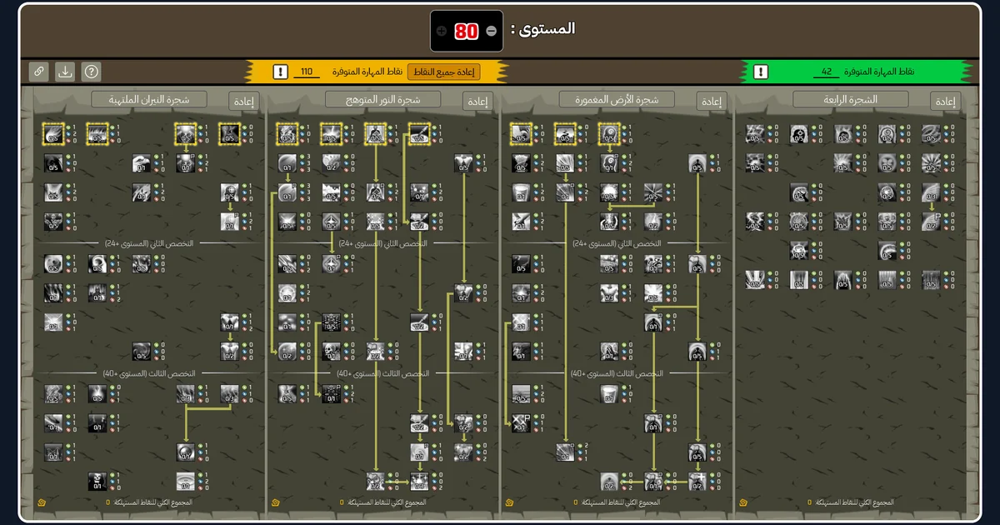
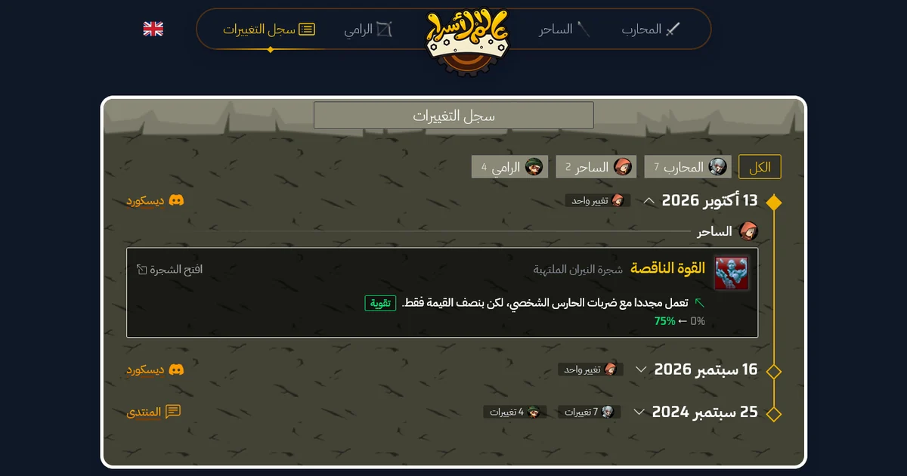

# Skill Tree Simulator for World of Secrets

A skill tree simulator for **World of Secrets** (عالم الأسرار). Plan a build for any class before spending points in the game, then share it with a link or a picture.

**Live site:** _coming soon_



## Features

- **Every tree of the three classes.** Warrior, Mage and Archer, with their four trees, laid out like the in-game window.
- **The game's rules.** Points available per level, job tiers, required skills and required tree points are all checked. Skills that lose points after a level change or a removed requirement get a red outline.
- **Skill cards.** Hover a skill, or long-press it on a phone, to see its card with the values at the current level and a table of every level.
- **Level box.** Type a level, or use the − and + buttons.
- **Share link.** The page address holds the build, so copying the link shares it, and it survives a language switch.
- **Image download.** Saves the whole board as a PNG, with the same layout from any screen.
- **Change log.** Skill changes from each patch, grouped by date and class, with links to the Discord or forum announcements and an "Open tree" link to each skill.
- **Arabic and English.** Arabic by default, with English localization.
- **Phones and wide screens.** Responsive on mobile and wide screens.



## Built with

- [Laravel 13](https://laravel.com) (PHP 8.3+), Blade
- [Alpine.js](https://alpinejs.dev) for the page interactions, around a skill tree engine in plain JavaScript
- [Tailwind CSS 4](https://tailwindcss.com) and [Vite](https://vite.dev)
- [spatie/laravel-translatable](https://github.com/spatie/laravel-translatable) for the Arabic and English game texts
- [modern-screenshot](https://github.com/qq15725/modern-screenshot) for the image download
- Saira Semi Condensed and IBM Plex Sans Arabic fonts, bundled with the site

## Running it locally

You need PHP 8.3 or newer, [Composer](https://getcomposer.org) and Node.js 20.19 or newer.

```bash
git clone <repository-url> skill-tree-simulator
cd skill-tree-simulator

composer install
npm install

cp .env.example .env
php artisan key:generate

php artisan migrate --seed
npm run build

php artisan serve
```

`.env.example` uses SQLite, which is all the site needs: the database only holds the game data that the seeder loads. To use MySQL instead, set the `DB_*` values in `.env` before migrating.

## Game data

All game data lives in plain PHP arrays in `database/data/`, and `php artisan migrate:fresh --seed` rebuilds the database from them.

| File | What it holds |
|---|---|
| `skill_trees.php` | The 4 trees of each class |
| `skills_warrior.php`, `skills_mage.php`, `skills_archer.php` | Every skill: names, texts, values per level, requirements, position in the tree |
| `skill_tree_connections.php` | The lines between skills |
| `change_logs.php` | One row per skill change |
| `change_log_sources.php` | The announcement links of each patch date |

Texts are stored in both languages, as `['ar' => '…', 'en' => '…']`. In skill descriptions, `:x`, `:y` and so on are replaced by that level's values from `levels`.

**Never change a skill's `id`.** Shared build links store skills by id, so changing one breaks every link that uses it.

### Adding a patch to the change log

1. Add the announcement to `change_log_sources.php`, with the patch date in `dt`.
2. Add one row per change to `change_logs.php`, with the same `dt`, the class in `cl` and the skill in `skill_id`. Put the old and new values in `first_part` and `second_part` (for example `'3%/6%/9%'` and `'2%/4%/6%'`), or leave both `null` for a change described only in words. `is_up` sets the arrow and `is_buff` the colour (green when the change is good for the player).
3. If the skill itself changed, update it in its `skills_*.php` file too.
4. Run `php artisan migrate:fresh --seed`.

## Tests

```bash
php artisan test     # pages, languages and checks on the game data
npm run test:js      # the skill tree engine, layout, skill cards and share links
```

## License

The code is released under the [MIT License](LICENSE).

World of Secrets and its names, texts and images belong to their owners. This is an unofficial fan project, and the game assets are not covered by the license.
